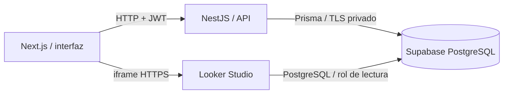

# PowerPOS · Supabase y Looker Studio

Copia académica independiente de [PowerPos-Pioneers](https://github.com/StivenR1128/PowerPos-Pioneers), basada en el commit `fca5fad`. Conserva POS, cocina, productos, inventario, caja y clientes. Prepara la persistencia en PostgreSQL administrado en Supabase e incorpora un informe externo en el dashboard principal.

## Estado de la entrega

[Aplicación publicada](https://powerpos-ucaldas34265.vercel.app) · [Informe de Looker](https://datastudio.google.com/reporting/f1f02891-9021-4b2b-a489-519206715977/page/423AG) · [Video demostrativo](https://github.com/StivenR1128/PowerPOS-Supabase-Looker/blob/main/docs/practica/media/PowerPOS-demostracion.mp4).

La base universitaria tiene 26 tablas y datos iniciales. Se verificaron creación, lectura, edición y baja desde la interfaz, además de una venta real de prueba (pedido 181). Los dos filtros funcionan dentro del iframe. **Pendiente:** en el navegador de Codex, los gráficos de líneas y barras configurados en Looker aparecen en blanco; aún no se confirma su visualización. Ver [estado y evidencias](docs/practica/ENTREGA.md).

Acceso de demostración: `admin@powerpos.demo` / `Practica2026*`. Son datos ficticios exclusivos de esta copia académica.

## Arquitectura



Se conservan Prisma y JWT. La consigna permite credenciales directas de PostgreSQL: no hace falta una clave Supabase en el navegador. `powerpos_app` es exclusivo del servidor; NestJS valida roles y empresa. RLS restringe tablas al rol backend y se revocan permisos de `anon` y `authenticated`. La credencial del servidor permite operar todas las empresas y no debe entregarse a clientes públicos.

## Modelo y SQL

- [DER completo: 26 tablas](docs/practica/DER.md) y [auditoría](docs/practica/AUDITORIA.md).
- [schema.sql](database/schema.sql): tipos, tablas, relaciones, índices y restricciones.
- [seed.sql](database/seed.sql): datos ficticios; aborta si ya existen empresas.
- [security.sql](database/security.sql): RLS, revocaciones y roles.
- [analytics.sql](database/analytics.sql): vista aislada de ventas sin información personal.
- [verify.sql](database/verify.sql): conteos, importes y permisos.

El seed contiene 180 pedidos, 360 detalles, 230 movimientos financieros, 720 movimientos de inventario y al menos 60 filas en las demás tablas transaccionales. Incluye 60 días históricos y distribuciones desiguales por producto, categoría, sucursal y forma de pago. Los catálogos tienen cantidades acordes a su función. El inventario y la producción son demostrativos; no representan una reconstrucción contable completa de recetas.

## Requisitos

Node.js 22 LTS o posterior compatible, npm y una instancia **nueva y exclusiva de la práctica** en Supabase. Docker y Redis no son necesarios para esta conexión. Los lockfiles de `api/` y `web/` fijan las versiones.

## Configurar Supabase

1. Crear `PowerPOS-Supabase-Looker` en la cuenta elegida, sin reutilizar la base original.
2. En SQL Editor ejecutar en orden: `schema.sql`, `seed.sql`, `security.sql`, `analytics.sql`, `verify.sql`, todos de `database/`. `constraints.sql` está incorporado a `schema.sql`: **no ejecutarlo dos veces**.
3. Configurar contraseñas privadas y `LOGIN` para `powerpos_app` y `powerpos_looker`. Los roles nacen como `NOLOGIN`. Ver [conexiones](docs/practica/CONEXIONES.md).
4. Copiar desde **Connect > Session pooler** el host y usuario exactos, puerto `5432`, base `postgres` y TLS. Usuarios del pooler: `powerpos_app.PROJECT_REF` y `powerpos_looker.PROJECT_REF`.
5. No subir `.env` ni contraseñas a GitHub. Compartir parámetros privados con el docente por un canal privado.

La creación inicial utiliza `schema.sql`, no las migraciones históricas del original. No ejecutar `prisma migrate reset`, `db push --accept-data-loss` ni el seed en producción. El seed nuevo no borra datos.

## Ejecución local

Desde la carpeta del proyecto:

```powershell
Copy-Item api/.env.example api/.env
Copy-Item web/.env.example web/.env.local
```

Editar `api/.env`: conexión real `DATABASE_URL`, `JWT_SECRET` aleatorio de al menos 32 caracteres y `CORS_ORIGINS=http://localhost:3001`. Editar `web/.env.local`: `NEXT_PUBLIC_API_URL=http://localhost:3000` y la URL real del iframe cuando exista.

Terminal 1:

```powershell
cd api
npm ci
npx prisma generate
npm run start:dev
```

Terminal 2:

```powershell
cd web
npm ci
npm run dev -- --port 3001
```

Abrir `http://localhost:3001`. Cuenta ficticia: **`admin@powerpos.demo` / `Practica2026*`**. La caja Centro está abierta a nombre del administrador para demostrar ventas. También existen `gerente@powerpos.demo`, `cajero@powerpos.demo`, `cocina@powerpos.demo` y `domiciliario@powerpos.demo` con la misma contraseña. Para vender como cajero, asignarle una caja abierta. `aislado@powerpos.demo` pertenece a otra empresa para comprobar aislamiento.

## Looker Studio

Seguir [la guía](docs/practica/LOOKER-STUDIO.md). Conectar con PostgreSQL y pegar `database/looker-query.sql` en **CUSTOM QUERY**, necesario para leer el esquema `reporting`.

Incluir tarjetas, línea diaria, barras por categoría y circular de medios de pago. Controles: fechas y categoría; sucursal opcional. Para pedidos usar recuento distinto de `pedido_id`; nunca sumar IDs ni contar detalles como pedidos. La vista distribuye importes por detalle y evita duplicar ingresos.

Habilitar inserción y copiar el `src` HTTPS a `NEXT_PUBLIC_LOOKER_EMBED_URL`. Reiniciar desarrollo o recompilar producción: Next.js incorpora variables públicas durante el build. El informe aparece en `/dashboard` para restaurantes y comercios; Home dirige allí a administradores y gerentes. Sin URL válida se muestra un estado pendiente.

## Pruebas y despliegue

```powershell
cd api
npm run build
npm test -- --runInBand
npm run start:prod
```

```powershell
cd web
npm run build -- --webpack
npm run start -- --port 3001
```

Ver [despliegue](docs/practica/DESPLIEGUE.md) y [guion del video](docs/practica/VIDEO.md). `docs/practica/SQL-QA.json` registra pruebas en PostgreSQL embebido: **no reemplazan** la prueba de interfaz y HTTP contra Supabase.

Tras configurar la API real de la base ficticia, puede ejecutarse `scripts/smoke-api.mjs` con las variables `POWERPOS_API_URL` y `POWERPOS_DEMO_PASSWORD`. Comprueba login, creación/edición/lectura/baja de producto y registro/lectura de venta; genera IDs para contrastarlos en Supabase. No se ejecuta sobre el sistema original y no se ha marcado como verificado sin conexión real.

## Repositorio independiente

Rama `practica-supabase-looker`. El remoto `source-original` tiene el destino de push bloqueado. Crear un repositorio nuevo y añadirlo como `origin`. No cambiar el destino de subida al repositorio original.

## Referencias

- [Supabase con Prisma](https://supabase.com/docs/guides/database/prisma).
- [Conector PostgreSQL](https://docs.cloud.google.com/looker/docs/studio/connect-to-postgresql).
- [Insertar informes](https://docs.cloud.google.com/looker/docs/studio/embed-a-report).

PostgreSQL confirma la persistencia al finalizar la transacción. Looker usa caché y frescura de datos configurable; recargar el iframe no garantiza invalidar la caché. La demostración debe contemplar actualizar el informe/fuente cuando corresponda.
